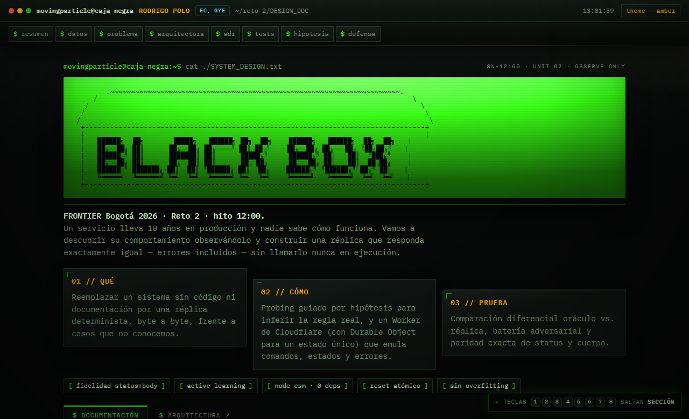

<p align="center">
  <a href="https://reto-caja-negra.pages.dev/">
    
  </a>
</p>

# Reto 2 · La Caja Negra — Reemplazo autónomo

Reemplazo determinista y **autónomo** de un servicio bancario heredado (10 años en
producción, sin código ni documentación) para **FRONTIER Bogotá 2026**. Reproduce con
paridad exacta el protocolo, los estados, los códigos HTTP y los mensajes de error del
original, incluidos sus errores tipográficos históricos.

- **Entrypoint de producción (Cloudflare Workers):**
  `https://caja-negra-reemplazo.parsec-ai-labs.workers.dev`
- **Documento de diseño navegable:** `https://reto-caja-negra.pages.dev/`
- **Diagrama de arquitectura:** `https://reto-caja-negra.pages.dev/architecture`

> El reemplazo **no llama** al servicio original ni a otro reemplazo: es 100% autónomo.

---

## 1. Qué resuelve

Un servicio sin código fuente recibe mensajes por HTTP en `POST /msg`. Solo se observa
`INPUT → CAJA → OUTPUT`. El trabajo consiste en **inferir la regla** (no memorizar ejemplos)
y reimplementarla, generalizando a casos no vistos.

**Hallazgos clave (ver `SPEC.md` y `CHALLENGE_ANALYSIS.md`):**

- El campo de control es un **ISO 7064 Mod 97-10 alfanumérico 1-based**
  (`CD = (98 − (N·100)) mod 97`). Verificado en 16/16 ejemplos. Implementado en
  `src/checksum.mjs`.
- Comandos: `PING`, `ALTA`, `CONSULTA`, `DEPOSITO`, `TRANSFER`, `ANULA` (case-insensitive).
- 17 códigos de error exactos (`E0xx`–`E5xx`) con mensajes literales (incluye el espacio
  final de `"comando desconocido "` y el typo `"recieved"`).
- Precedencia de validación determinada (p. ej. `E303` > `E304` > `E401` > `E506` > `E507`).

---

## 2. Contrato del entrypoint

| Método | Ruta        | Cabecera requerida        | Comportamiento |
| ------ | ----------- | ------------------------- | -------------- |
| `GET`  | `/health`   | `Authorization: Bearer <token>` | `200 {"ok":true}` cuando está listo |
| `POST` | `/__reset`  | `Authorization: Bearer <token>` | Reinicia el estado a cero |
| `POST` | `/msg`      | `Authorization: Bearer <token>` | Cuerpo JSON `{"m":"CMD;arg;...;control"}` |
| `*`    | `/*`        | —                         | `404 {"error":"E404","mensaje":"ruta desconocida"}` |

- Cuerpo de `/msg` limitado a **8 KiB** (mayor → `413 E101`).
- Estado **único global** garantizado con **Cloudflare Durable Objects** (un solo proceso
  lógico, tal como lo asume el arnés de evaluación).
- Autenticación **timing-safe** (comparación byte a byte en tiempo constante).

---

## 3. Inicio rápido (local)

Requisitos: **Node.js ≥ 20** (sin dependencias npm).

```bash
# Servidor local en http://0.0.0.0:3000
npm start

# Batería de tests (paridad + adversariales + worker)
npm test
```

Variables de entorno opcionales: `PORT`, `TEAM_TOKEN`.

---

## 4. Despliegue (Cloudflare Workers)

Configuración nativa con Durable Objects en `wrangler.toml`:

```bash
npx wrangler deploy
```

---

## 5. Estructura del repositorio

```text
reto-caja-negra/
├── index.mjs                 # Entrypoint local (Node) -> src/server.mjs
├── src/
│   ├── checksum.mjs          # ISO 7064 Mod 97-10 (integridad)
│   ├── engine.mjs            # Máquina de estados y reglas de negocio
│   ├── security.mjs          # Auth timing-safe, límites, saneo
│   ├── server.mjs            # Servidor HTTP local (node:http)
│   └── worker.mjs            # Cloudflare Worker + Durable Object (producción)
├── tests/                    # 11 tests: Paridad 20/20, adversariales, worker
├── pruebas/ejemplos.jsonl    # 20 casos públicos de referencia
├── experimentos.jsonl        # Log de probes reales (hipótesis -> resultado)
├── SPEC.md                   # Especificación deducida (comportamiento por ID)
├── LOG.md / LOG.html         # Bitácora de 40 sondas: hipótesis antes/después y decisión
├── CHALLENGE_ANALYSIS.md     # Análisis del reto, opciones y matriz de tests
├── TECHNICAL_DEFENSE.md      # Defensa técnica (debrief)
├── DESIGN_DOC.md / .html     # Documento de System Design (hito 12:00)
├── architecture.html         # Diagrama de arquitectura (C4)
├── architecture.mmd          # Diagramas C4 en Mermaid
├── docs/decisions/           # ADRs (MADR 4.0)
├── wrangler.toml             # Config de Cloudflare Workers
└── src / tests / scripts
```

---

## 6. Cómo se verifica

```bash
npm test
```

Cubre, entre otros:

- **Paridad exacta** de los 20 ejemplos públicos (`pruebas/ejemplos.jsonl`).
- **Integridad**: control válido, inválido (`E202`), mal formado (`E201`), faltante (`E103`),
  segmentos vacíos (`E104`), ceros iniciales.
- **Adversariales**: límite 100.000, precedencia de errores, reversión de `ANULA`, aridad.
- **Worker**: hardening, autenticación multi-clave, límite 8 KiB.

---

## 7. Documentación

- [`DESIGN_DOC.md`](DESIGN_DOC.md) · [`DESIGN_DOC.html`](DESIGN_DOC.html) — System Design.
- [`SPEC.md`](SPEC.md) — comportamiento inferido con evidencia y nivel de confianza.
- [`LOG.md`](LOG.md) · [`LOG.html`](LOG.html) — bitácora de sondas (hipótesis antes/después, decisión).
- [`experimentos.jsonl`](experimentos.jsonl) — log de experimentos.
- [`docs/decisions/`](docs/decisions/README.md) — decisiones de arquitectura (MADR).
- [`INCIDENT.md`](INCIDENT.md) — registro del incidente.

---

## 8. Limitaciones conocidas

- Estado **por proceso**: el runtime local es de un solo proceso; en producción se garantiza
  un único estado global con un Durable Object con nombre fijo (`global-caja-negra`).
- `ANULA` revierte el efecto de la operación (transferencia o depósito) y **permite saldos
  negativos**, tal como se observó en el oráculo (ver `SPEC.md` §3.6 y §CMD-13).

## 9. Reglas respetadas

- Sin llamadas al original ni a otro reemplazo.
- Scripts y fuzzers propios (permitidos) — ver `scripts/`.
- Repo público sin material privado del organizador.
